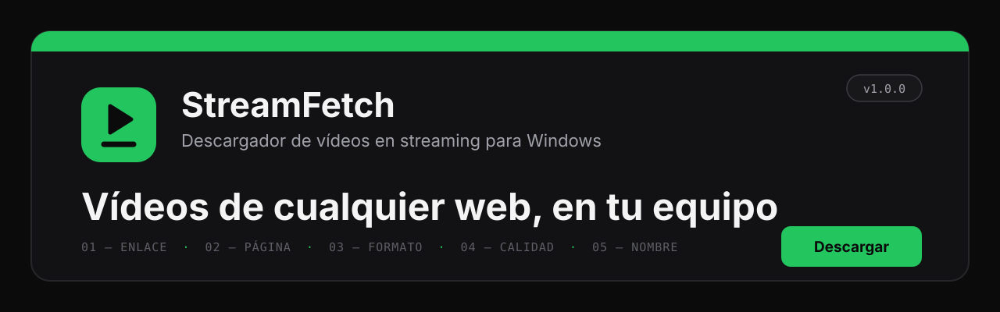
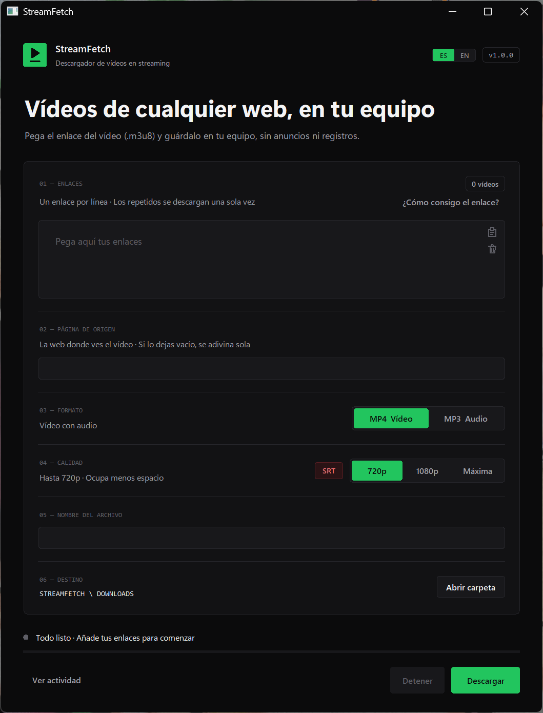

<p align="center">
  
</p>

<p align="center">
  <a href="README.md">English</a> · <b>Español</b>
</p>

<p align="center">
  
  
  
  
</p>

<p align="center">
  <b>Descargador de escritorio para vídeos en streaming (.m3u8) de cualquier web: clases, cursos, webinars.</b><br>
  Pega el enlace del vídeo, pulsa <b>Descargar</b> y obtén un MP4 listo para tu editor.<br>
  Proyecto hermano de <a href="https://github.com/juangalisteo/videofetch">VideoFetch</a>.
</p>

<p align="center">
  
</p>

---

## Índice

- [Por qué StreamFetch](#por-qué-streamfetch)
- [Qué hace](#qué-hace)
- [Requisitos](#requisitos)
- [Instalación](#instalación)
- [Cómo conseguir el enlace del vídeo](#cómo-conseguir-el-enlace-del-vídeo)
- [Cómo se usa](#cómo-se-usa)
- [Estructura del proyecto](#estructura-del-proyecto)
- [Tecnologías](#tecnologías)
- [Uso responsable](#uso-responsable)
- [Autores](#autores)
- [Licencia](#licencia)

---

## Por qué StreamFetch

Muchas plataformas de cursos y vídeos no tienen botón de descarga ni las entienden
herramientas como VideoFetch. Pero la página reproduce el vídeo desde un **enlace de streaming**
(`.m3u8`) que tu navegador ya recibe. StreamFetch descarga ese enlace diciéndole al servidor
**de qué página viene** (el *Referer*), que es lo que piden muchos servidores.

## Qué hace

| | |
|---|---|
| **Enlaces de streaming** | `.m3u8` (HLS), `.mpd` (DASH) o `.mp4` directos, y páginas que entienda [yt-dlp](https://github.com/yt-dlp/yt-dlp). Varios a la vez, uno por línea. |
| **Página de origen** | Se rellena sola (p. ej., enlaces de `tella.tv` → `https://www.tella.tv/`). Puedes escribir otra; se recuerda. |
| **Enlaces caducados** | Los enlaces firmados caducan. StreamFetch lee la fecha y, si ya pasó, te dice que lo copies de nuevo en vez de fallar sin explicar nada. |
| **Formato y calidad** | **MP4** o **MP3**, **720p / 1080p / Máxima**. El MP4 sale siempre en **H.264 + AAC**, listo para Sony Vegas, Premiere o DaVinci Resolve (con tarjeta NVIDIA / Intel / AMD si la hay). |
| **Subtítulos (SRT)** | Con el botón **SRT** encendido, también sale `nombre.srt`: del propio vídeo si los trae, o **creados con IA (Whisper)** en tu equipo y traducidos si hace falta. Ideal para la transcripción de una clase. |
| **Vídeos largos** | Muchos trozos a la vez y reintento automático de los que fallen: una clase de 2 horas se baja sin problemas. |
| **Idioma** | Ventana en **español** o **inglés** (**ES / EN** arriba). |

## Requisitos

- **Windows 10 u 11**
- **[Python 3.13](https://www.python.org/downloads/)** (marca *Add Python to PATH*)
- **[FFmpeg](https://ffmpeg.org/download.html)** (con `ffprobe`) en el PATH
- Conexión a Internet
- *(Botón SRT)* unos 700 MB más para Whisper y su modelo de IA. Con NVIDIA va mucho más rápido.

## Instalación

1. Descarga el proyecto (**Code → Download ZIP**, o la última **[versión](../../releases)**) y descomprímelo.
2. Abre **`02_ACTUALIZAR.cmd`** una vez (instala yt-dlp y Whisper en `SISTEMA\`).
3. Abre **`01_DESCARGAR.cmd`**. Si te saltaste el paso 2, te ofrece hacerlo.
4. *(Opcional)* **`03_CREAR_ACCESO_DIRECTO.cmd`** crea el acceso directo con su icono.

## Cómo conseguir el enlace del vídeo

1. Abre la página del vídeo o de la clase en Chrome, Edge o Firefox.
2. Pulsa **F12** y entra en la pestaña **Red** (*Network*).
3. Escribe **`m3u8`** en su buscador.
4. Dale al **Play** al vídeo: aparece una línea con `m3u8`.
5. Clic derecho → **Copiar → Copiar URL**, y pégalo en StreamFetch.

Estos pasos también están dentro de la app: **«¿Cómo consigo el enlace?»**.

> [!IMPORTANT]
> Estos enlaces suelen **caducar en unas horas**. Cópialo justo antes de descargar.

## Cómo se usa

1. **01 · Enlace del vídeo**: pega el enlace `.m3u8` (uno por línea).
2. **02 · Página de origen**: déjala vacía (automática) o escribe la web donde ves el vídeo.
3. **03 · Formato**: MP4 o MP3.
4. **04 · Calidad**: 720p, 1080p o Máxima, y **SRT** si quieres subtítulos.
5. **05 · Nombre del archivo**: p. ej. `Clase 3 - Diseño web`. Vacío = el título del vídeo o `StreamFetch <fecha>`.
6. Pulsa **Descargar**. Los archivos van a `STREAMFETCH\DOWNLOADS`.

Desde la consola:

```bat
python APP\descargador.py "https://…/manifest.m3u8" --referer https://www.tella.tv/ --name "Mi clase" --srt
```

## Estructura del proyecto

```
STREAMFETCH
├── 00_LEEME.txt / 00_README_EN.txt   Guía rápida (español / inglés)
├── 01_DESCARGAR.cmd                  Abre la ventana
├── 02_ACTUALIZAR.cmd                 Instala / actualiza yt-dlp y Whisper en SISTEMA\
├── 03_CREAR_ACCESO_DIRECTO.cmd       Acceso directo en el escritorio
├── APP\
│   ├── interfaz.py                   Ventana (Tkinter)
│   ├── descargador.py                Lógica de descarga (también modo consola)
│   ├── idiomas.py                    Todos los textos en español e inglés
│   └── streamfetch.ico               Icono
├── DOWNLOADS\                        Vídeos descargados
├── SISTEMA\                          yt-dlp, Whisper y dependencias (se crea con 02_ACTUALIZAR)
├── docs\                             Imágenes del README
├── README.md / README.es.md
├── CHANGELOG.md / CHANGELOG.es.md
├── requirements.txt
└── LICENSE
```

## Tecnologías

| | |
|---|---|
| **Python 3.13 + Tkinter** | App de escritorio con diseño propio |
| **yt-dlp** | Descarga streams HLS / DASH con las cabeceras correctas |
| **FFmpeg** | Unión, conversión a H.264 y audio para Whisper |
| **faster-whisper** | IA que pasa la voz a texto para los subtítulos |
| **deep-translator** | Traducción de los subtítulos |

Hecho sobre la misma base que [VideoFetch](https://github.com/juangalisteo/videofetch): mismo sistema de diseño (grafito + un solo color de señal: **verde** aquí, naranja allí), mismos textos ES/EN y el mismo motor de subtítulos.

## Uso responsable

StreamFetch sirve para guardar **vídeos a los que tienes acceso y permiso para conservar**, por
ejemplo las clases de un curso en el que estás inscrito, para estudiar. Respeta los derechos de
autor y las normas de cada plataforma. StreamFetch **no se salta DRM**, inicios de sesión ni
muros de pago: solo descarga lo que tu navegador ya puede reproducir.

## Autores

| | Papel | GitHub |
|---|---|---|
| **Juan Bautista Galisteo Marqués** | Autor y responsable del proyecto | [@juangalisteo](https://github.com/juangalisteo) |
| **Juan Manuel Casado Triguero** | Colaborador | [@juanmacasado](https://github.com/juanmacasado) |

## Licencia

Distribuido bajo la **Licencia Pública General de GNU v3.0** (GPL-3.0 o posterior). Consulta [LICENSE](LICENSE).

Copyright © 2026 Juan Bautista Galisteo Marqués y Juan Manuel Casado Triguero.

<p align="center"><sub>StreamFetch v1.0.0 · Juan Bautista Galisteo Marqués y Juan Manuel Casado Triguero</sub></p>
