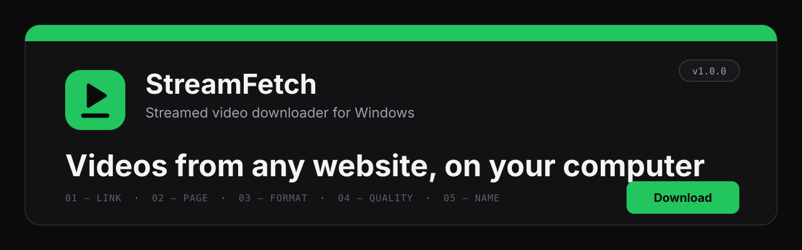
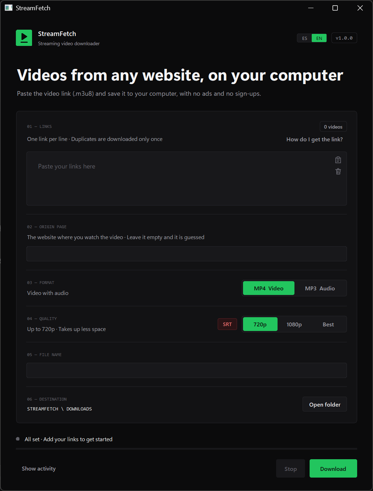

<p align="center">
  
</p>

<p align="center">
  <b>English</b> · <a href="README.es.md">Español</a>
</p>

<p align="center">
  
  
  
  
</p>

<p align="center">
  <b>A desktop downloader for streamed videos (.m3u8) from any web page — classes, courses, webinars.</b><br>
  Paste the video link, press <b>Download</b>, and get an MP4 ready for your video editor.<br>
  Sister project of <a href="https://github.com/juangalisteo/videofetch">VideoFetch</a>.
</p>

<p align="center">
  
</p>

---

## Contents

- [Why StreamFetch](#why-streamfetch)
- [Features](#features)
- [Requirements](#requirements)
- [Installation](#installation)
- [How to get the video link](#how-to-get-the-video-link)
- [How to use it](#how-to-use-it)
- [Project structure](#project-structure)
- [Tech stack](#tech-stack)
- [Responsible use](#responsible-use)
- [Authors](#authors)
- [License](#license)

---

## Why StreamFetch

Many course and video platforms don't offer a download button and aren't supported by
tools like VideoFetch. But the page plays the video from a **stream link** (`.m3u8`) that
your browser already receives. StreamFetch downloads that link, telling the server which
**page** it comes from (the *Referer*), which is what many servers require.

## Features

| | |
|---|---|
| **Stream links** | `.m3u8` (HLS), `.mpd` (DASH) or direct `.mp4` links, and pages that [yt-dlp](https://github.com/yt-dlp/yt-dlp) understands. Several links at once, one per line. |
| **Origin page** | Filled in automatically (e.g. `tella.tv` links → `https://www.tella.tv/`). You can type another one; it is remembered. |
| **Expired links** | Signed links expire. StreamFetch reads the expiry date and, if the link is old, tells you to copy it again instead of failing silently. |
| **Format & quality** | **MP4** or **MP3**, **720p / 1080p / Best**. MP4 always comes out as **H.264 + AAC**, ready for Sony Vegas, Premiere or DaVinci Resolve (NVIDIA / Intel / AMD acceleration when available). |
| **Subtitles (SRT)** | With the **SRT** button on, you also get `name.srt`: from the stream if it has them, or **created with AI (Whisper)** on your computer and translated if needed. Perfect for class transcripts. |
| **Long videos** | Many fragments in parallel and automatic retries of lost pieces, so a 2-hour class downloads reliably. |
| **Language** | Window in **English** or **Spanish** (**ES / EN** at the top). |

## Requirements

- **Windows 10 or 11**
- **[Python 3.13](https://www.python.org/downloads/)** (tick *Add Python to PATH*)
- **[FFmpeg](https://ffmpeg.org/download.html)** (with `ffprobe`) on the PATH
- An Internet connection
- *(SRT button)* about 700 MB extra for Whisper and its AI model. An NVIDIA card makes it much faster.

## Installation

1. Download the project (**Code → Download ZIP**, or the latest **[Release](../../releases)**) and unzip it.
2. Run **`02_ACTUALIZAR.cmd`** once (it installs yt-dlp and Whisper into `SISTEMA\`).
3. Run **`01_DESCARGAR.cmd`**. If you skipped step 2, it offers to do it for you.
4. *(Optional)* **`03_CREAR_ACCESO_DIRECTO.cmd`** creates a desktop shortcut with the icon.

> [!NOTE]
> The launcher names are in Spanish (`DESCARGAR` = download, `ACTUALIZAR` = update, `CREAR_ACCESO_DIRECTO` = create shortcut), as in VideoFetch.

## How to get the video link

1. Open the video or class page in Chrome, Edge or Firefox.
2. Press **F12** and open the **Network** tab.
3. Type **`m3u8`** in its filter box.
4. Press **Play** on the video: a line with `m3u8` appears.
5. Right-click it → **Copy → Copy URL**, and paste it into StreamFetch.

The same steps are inside the app: **“How do I get the link?”**.

> [!IMPORTANT]
> These links usually **expire within hours**. Copy the link right before downloading.

## How to use it

1. **01 · Video link**: paste the `.m3u8` link (one per line).
2. **02 · Origin page**: leave it empty (automatic) or type the page where you watch the video.
3. **03 · Format**: MP4 or MP3.
4. **04 · Quality**: 720p, 1080p or Best, and **SRT** if you want subtitles.
5. **05 · File name**: e.g. `Class 3 - Web design`. Empty = the video title or `StreamFetch <date>`.
6. Press **Download**. Files go to `STREAMFETCH\DOWNLOADS`.

From the console:

```bat
python APP\descargador.py "https://…/manifest.m3u8" --referer https://www.tella.tv/ --name "My class" --srt
```

## Project structure

```
STREAMFETCH
├── 00_LEEME.txt / 00_README_EN.txt   Quick guide (Spanish / English)
├── 01_DESCARGAR.cmd                  Opens the window
├── 02_ACTUALIZAR.cmd                 Installs / updates yt-dlp and Whisper in SISTEMA\
├── 03_CREAR_ACCESO_DIRECTO.cmd       Desktop shortcut
├── APP\
│   ├── interfaz.py                   Window (Tkinter)
│   ├── descargador.py                Download logic (also console mode)
│   ├── idiomas.py                    Every text in Spanish and English
│   └── streamfetch.ico               Icon
├── DOWNLOADS\                        Downloaded videos
├── SISTEMA\                          yt-dlp, Whisper and dependencies (created by 02_ACTUALIZAR)
├── docs\                             README images
├── README.md / README.es.md
├── CHANGELOG.md / CHANGELOG.es.md
├── requirements.txt
└── LICENSE
```

## Tech stack

| | |
|---|---|
| **Python 3.13 + Tkinter** | Desktop app with a custom design |
| **yt-dlp** | Downloads HLS / DASH streams with the right headers |
| **FFmpeg** | Merging, H.264 conversion and audio for Whisper |
| **faster-whisper** | Speech-to-text AI for the subtitles |
| **deep-translator** | Translation of the subtitles |

Built on the same base as [VideoFetch](https://github.com/juangalisteo/videofetch): same design system (graphite + one signal colour — **green** here, orange there), same texts system and same subtitle engine.

## Responsible use

StreamFetch is for saving **videos you have access to and permission to keep** — for example,
classes from a course you are enrolled in, for your own study. Respect copyright and each
platform's terms. StreamFetch **does not bypass DRM**, logins or paywalls: it only downloads
what your browser is already allowed to play.

## Authors

| | Role | GitHub |
|---|---|---|
| **Juan Bautista Galisteo Marqués** | Author and project lead | [@juangalisteo](https://github.com/juangalisteo) |
| **Juan Manuel Casado Triguero** | Collaborator | [@juanmacasado](https://github.com/juanmacasado) |

## License

Released under the **GNU General Public License v3.0** (GPL-3.0-or-later). See [LICENSE](LICENSE).

Copyright © 2026 Juan Bautista Galisteo Marqués and Juan Manuel Casado Triguero.

<p align="center"><sub>StreamFetch v1.0.0 · Juan Bautista Galisteo Marqués and Juan Manuel Casado Triguero</sub></p>
